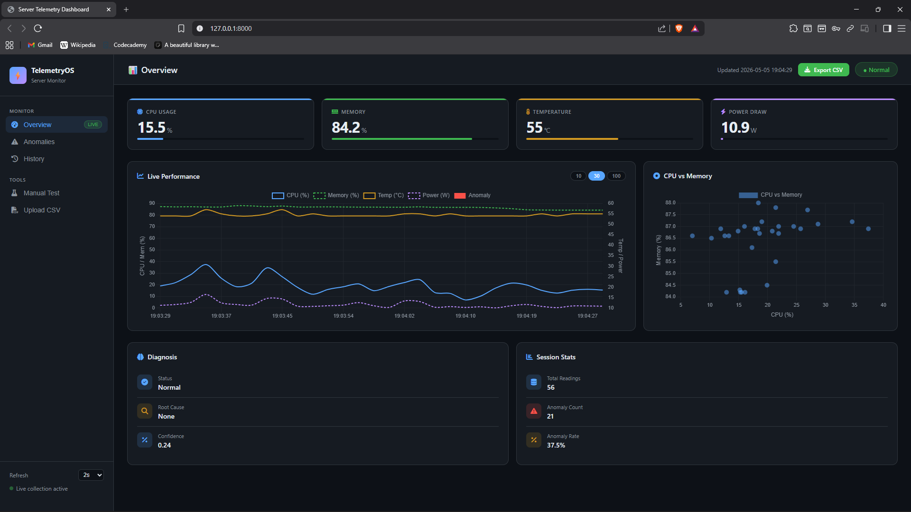
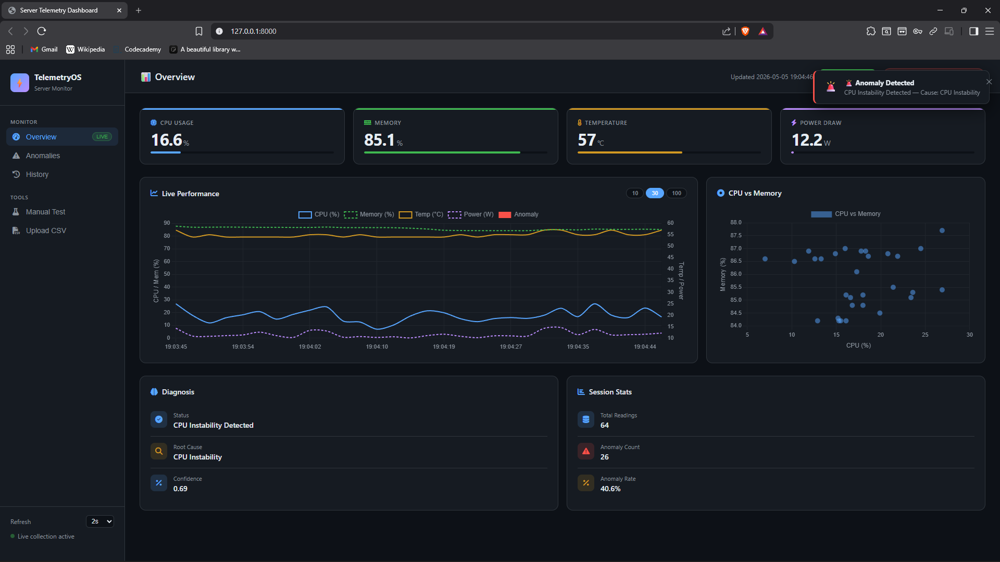
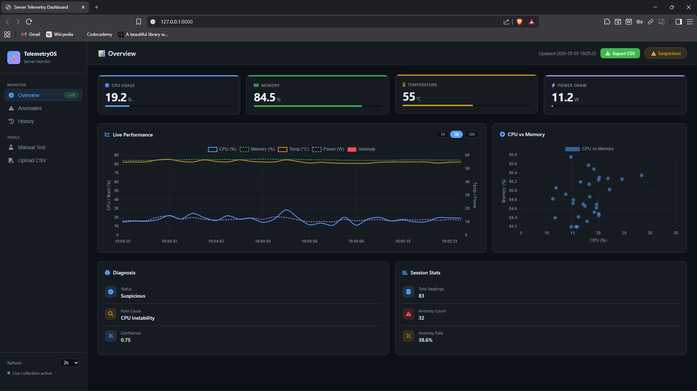
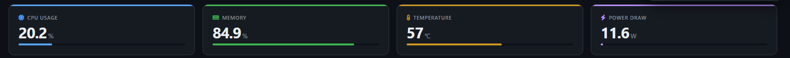
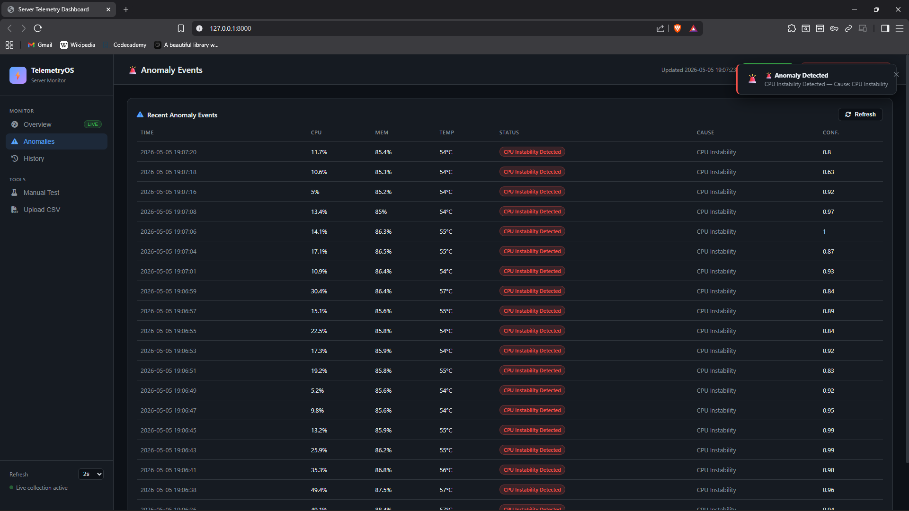
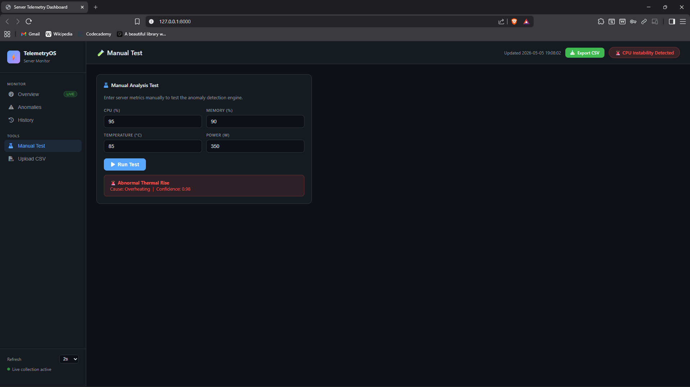
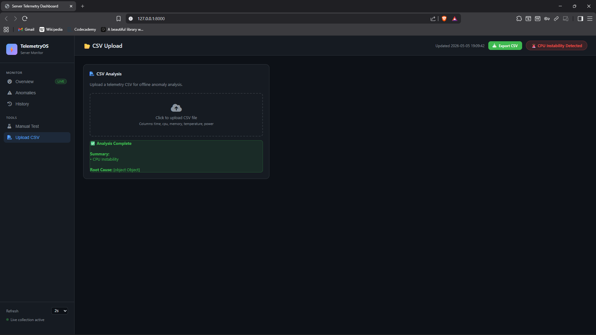

# Intelligent System Health Monitoring System (ISHMS)

A real-time system telemetry and anomaly detection platform built with Django. ISHMS continuously monitors CPU usage, memory consumption, temperature, and power draw — and uses a machine learning model to automatically detect anomalies and diagnose their root cause.

---

## Screenshots

### Dashboard — Normal State


### Dashboard — Anomaly Detected


### Dashboard — Suspicious State


### Live Metrics Panel


### Anomaly Events


### Manual Test


### CSV Upload & Offline Analysis


---

## Features

- **Real-time monitoring** — collects system metrics every 2 seconds via `psutil`
- **ML-based anomaly detection** — `RandomForestClassifier` trains automatically on collected data and flags abnormal behaviour
- **Root cause analysis** — rule-based engine identifies Memory Leak, CPU Instability, Overheating, Power Spike, or System Overload
- **Live dashboard** — browser-based UI with real-time charts, current metrics, and anomaly history
- **Offline analysis** — upload a CSV file to run anomaly analysis without live collection
- **Manual testing** — enter custom CPU/memory/temperature/power values and get an instant prediction
- **Data export** — download all collected readings as a CSV file
- **REST API** — all data accessible via clean JSON endpoints

---

## Tech Stack

| Layer | Technology |
|---|---|
| Backend | Django 4.2 |
| Database | SQLite |
| ML Model | scikit-learn (RandomForestClassifier) |
| Data Processing | pandas |
| System Metrics | psutil |
| Sensor Data (optional) | LibreHardwareMonitor |
| Frontend | HTML, CSS, JavaScript, Chart.js |

---

## Project Structure

```
telemetry_django/
├── manage.py                          # Django entry point
├── run.py                             # Starts collector + server together
├── requirements.txt
├── screenshots/                       # README screenshots
├── telemetry/                         # Django project config
│   ├── settings.py
│   ├── urls.py
│   └── wsgi.py
└── dashboard/                         # Main Django app
    ├── models.py                      # TelemetryReading database model
    ├── views.py                       # All API endpoints and dashboard view
    ├── urls.py                        # URL routing
    ├── core/                          # Pure logic — no Django dependency
    │   ├── data_collector.py          # Reads CPU, memory, temperature, power
    │   ├── analyzer.py                # Orchestrates ML + rule-based detection
    │   ├── ml_model.py                # RandomForest train and predict
    │   ├── root_cause.py              # Rule-based root cause diagnosis
    │   └── offline_analyzer.py        # CSV upload analysis
    ├── services/                      # Business logic layer
    │   ├── analysis_service.py        # run_analyze() — bridges collector and ML
    │   └── monitoring_service.py      # get_history() — paginated DB queries
    ├── management/commands/
    │   └── collect_telemetry.py       # Custom Django command for data collection
    ├── migrations/
    └── templates/dashboard/
        └── index.html                 # Dashboard UI
```

---

## Getting Started

### Prerequisites

- Python 3.10 or higher
- pip

### Installation

```bash
# 1. Clone the repository
git clone https://github.com/your-username/ishms.git
cd ishms/telemetry_django

# 2. Create and activate a virtual environment
python -m venv venv

# Windows
venv\Scripts\activate

# Mac / Linux
source venv/bin/activate

# 3. Install dependencies
pip install -r requirements.txt

# 4. Set up the database
python manage.py migrate

# 5. Start the application
python run.py
```

Then open **http://127.0.0.1:8000** in your browser.

---

## Running Components Separately

If you want to run the collector and web server in separate terminals:

```bash
# Terminal 1 — Web server
python manage.py runserver

# Terminal 2 — Data collector
python manage.py collect_telemetry

# With custom interval (default is 2 seconds)
python manage.py collect_telemetry --interval 5
```

---

## API Reference

| Method | Endpoint | Description |
|---|---|---|
| GET | `/api/latest/` | Latest readings for live charts and current metric values |
| GET | `/api/anomalies/` | Last 20 detected anomaly events |
| GET | `/api/stats/` | Session statistics — totals, averages, anomaly rate |
| GET | `/api/history/` | Paginated and filterable reading history |
| GET | `/api/export/` | Download all readings as a CSV file |
| POST | `/api/manual-test/` | Run anomaly detection on custom input values |
| POST | `/api/upload-csv/` | Upload a CSV file for offline analysis |

---

## How It Works

### Data Collection
`psutil` reads CPU and memory every 2 seconds. Temperature and power are sourced from LibreHardwareMonitor if it is running, otherwise estimated from CPU load as a fallback.

### Anomaly Detection
A `RandomForestClassifier` trains automatically once 30 readings are accumulated in the database. It retrains every 50 new readings to stay up to date. Each reading is classified as one of:

| Status | Meaning |
|---|---|
| Normal | All metrics within expected range |
| Suspicious | A rising trend detected but not yet critical |
| Memory Leak Suspected | Consistent upward trend in memory usage |
| CPU Instability Detected | High variation in CPU usage over time |
| Abnormal Thermal Rise | Temperature exceeding safe threshold |
| Power Spike Detected | Sudden spike in power consumption |
| Confirmed Anomaly | Multiple indicators triggered simultaneously |

### Root Cause Analysis
After anomaly detection, a rule-based engine inspects the last 5 readings to determine the most likely cause and assigns a confidence score.

---

## Real Sensor Data (Optional)

By default, temperature and power are estimated. To get real sensor readings on Windows, download and run [LibreHardwareMonitor](https://github.com/LibreHardwareMonitor/LibreHardwareMonitor) with its web server enabled on port `8085`. ISHMS will automatically detect and use it.

---

## Environment Variables

| Variable | Default | Description |
|---|---|---|
| `DJANGO_SECRET_KEY` | dev key | Set a strong random key before deploying |
| `DEBUG` | `true` | Set to `false` in production |
| `ALLOWED_HOSTS` | `127.0.0.1,localhost` | Comma-separated list of allowed hosts |

---

## License

This project is licensed under the MIT License.